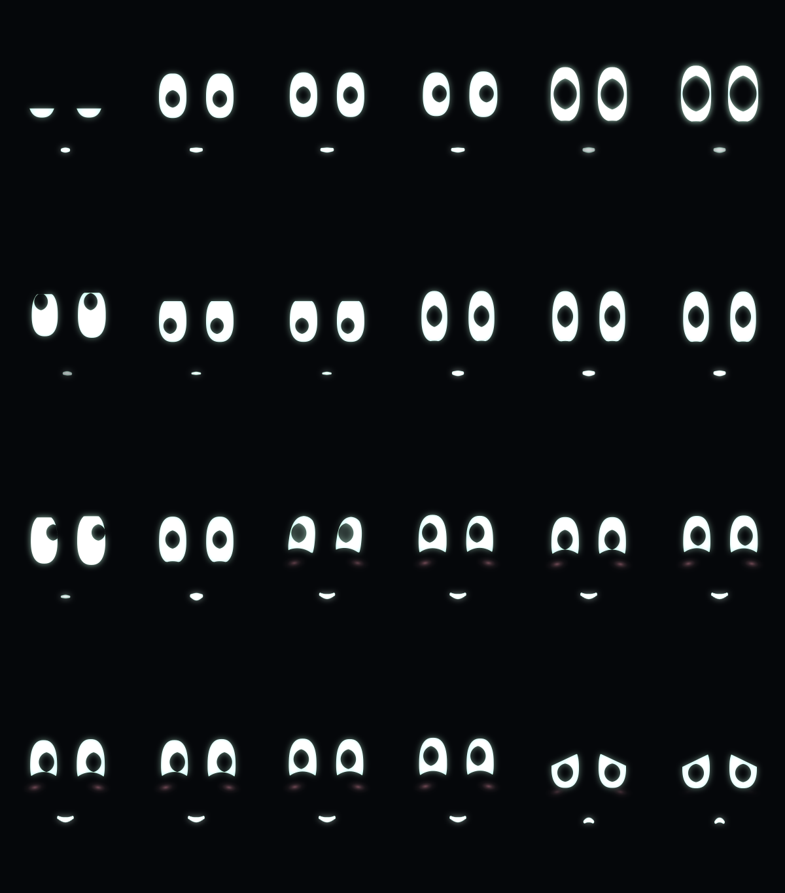

# node-face



The face on the frog node's screen: the Soft Blocks eyes, kawaii and glowing, at the head's panel resolution. It reuses [`puck`](../puck) to fold `frog --serve` into what frog is doing, and to draw anti-aliased shapes and text into a framebuffer.

```
cargo run -p node-face --features window -- --demo                 # a scripted turn, no model needed
cargo run -p node-face --features window                           # talk to `frog --serve` in this directory
cargo run -p node-face --features window -- --panel full           # the full head's 600×1024 portrait panel
cargo run -p node-face --features window -- --fullscreen           # borderless, on the head's own panel
cargo run -p node-face -- --sheet face.png                         # headless: the face through a whole turn
```

| frog | the face |
| --- | --- |
| idle | calm, glancing around every second or two, breathing, blinking with a frog's membrane |
| listening | eye contact: eyes open wider, pupils dilate, the glow pulses and flares with each word |
| thinking | glances up and away, pupils scan, three motes orbit, the glow pulses faster |
| running a command | focused, looking down at the work |
| asking to run something | attentive, at you |
| done | the eyes morph into a check, then a happy crescent with a blush |
| error | sad, looking down |
| words streaming | warm, at you, the eyes bounce with the words |

## Voice

With `--features voice` and `--voice`, the face speaks with [ribt](https://github.com/ecto/ipse/tree/main/crates/ribt), ipse's streaming TTS. One `ribt-tts stream --stdin --pcm -` runs for the session; frog's reply goes in word by word as it streams and audio comes back a chunk at a time, about 15 ms after the words (the model compiles once at start, a few seconds). The eyes bounce with the loudness of what's actually playing.

```
RIBT_TTS=path/to/ribt-tts cargo run -p node-face --features voice -- --demo --voice
```

The voice defaults to RIBT-2's af_heart speaker, pitch +1, Minnesota accent, from `~/.claude/voice/run2` (where the Claude Code announce hook keeps it). `RIBT_RUN`, `RIBT_CKPT`, `RIBT_VOC`, `RIBT_FLOW`, `RIBT_REF`, `RIBT_PITCH` and `RIBT_ACCENT` override it. ribt-tts must be new enough to `stream --stdin --pcm`. On the Orin, build ribt with `--features cuda`.

With `--voice` it's voice only: ipse's `hear mic` listens (streaming recognition in tang's IR, model from `$HEAR_MODEL`, default `~/hear-assets`; binary from `--hear` or `$HEAR_BIN`). Say "hey frog" and it listens; pause for a couple of seconds and it answers out loud, and for six seconds after it finishes you can answer back without the wake word. Say yes or no when it asks to run something, and "stop" while it works. Its ears close while it speaks, so it doesn't hear itself. Until the stereo camera can say where you are, the pointer stands in. The look was settled in `cortex/face/soft-blocks-lab.html` in the rose repo.

- `face.rs`: the character. Emotion (valence × arousal), gaze, glyph and the listening / thinking / talking levels, on springs.
- `ears.rs`: hear as a child process: finished words, the word being heard, turn ends.
- `voice.rs`: ribt as a child process, its PCM onto the speaker, loudness per 20 ms for the eyes.
- `draw.rs`: 64-point eye outlines (so they morph into glyphs), pupils, membrane, blush, motes, the portrait status line, and the bloom.
