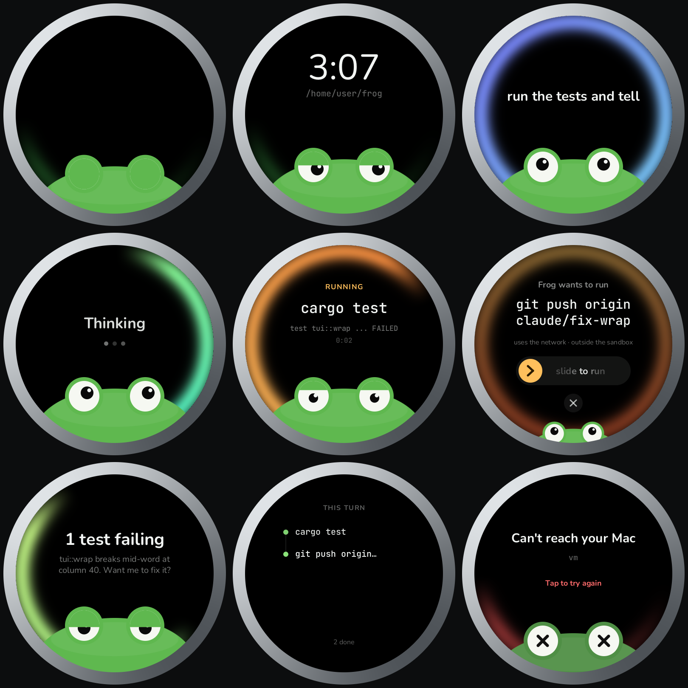

# puck

frog on a [Waveshare ESP32-S3 1.75″ round AMOLED](https://www.waveshare.com/esp32-s3-touch-amoled-1.75.htm) (466×466): a puck you talk to that runs frog on your computer.



This crate is the puck's UI, eyes and sounds as plain Rust over a framebuffer, plus `puck-sim`, a desktop window to build it in. The firmware will reuse the library and swap the window for the panel driver.

```
cargo run -p puck --features window -- --demo              # a scripted turn, no model needed
cargo run -p puck --features window                        # talk to `frog --serve` in this directory
cargo run -p puck --features window -- -- -m ollama/qwen3:8b   # arguments after the second -- go to frog
cargo run -p puck --features window,audio -- --demo        # with sound (needs ALSA headers on Linux)
cargo run -p puck -- --gallery gallery.png                 # headless: every screen
cargo run -p puck -- --shot frame.png --at 14              # headless: one frame of the demo
```

In the window, typing stands in for speech:

| input | on the puck |
| --- | --- |
| type | talk; Enter or a click on the glass sends it |
| click the glass | tap: start listening, or send |
| hold the glass | stop what frog is doing |
| space | the crown button: approve |
| drag the knob / click ✕ / Esc | slide to run / decline |
| ↑ | what ran this turn |
| W | say "hey frog" |
| right-drag | tilt the puck; flick it to shake the eyes |

## Layout

- `eyes.rs`: each pupil is the bob of a two-axis pendulum in phyz (`aba` plus semi-implicit Euler). Gravity comes from the IMU, joint springs pull toward where the frog wants to look, joint limits are the socket wall.
- `model.rs`: folds `--serve` events and taps into what the puck shows, and queues sound cues. It reads events as JSON so the firmware never links frog-engine.
- `ui.rs`: the screens. Rim glow for state, eyes for mood, one sentence of text.
- `canvas.rs`, `text.rs`: anti-aliased SDF shapes and fontdue text.
- `sound.rs`, `assets/sfx`: the cue sounds, 24 kHz mono, regenerated by `assets/sfx/synth.py`.

Fonts are Nunito and JetBrains Mono, both SIL OFL.
