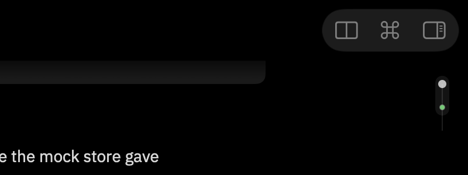
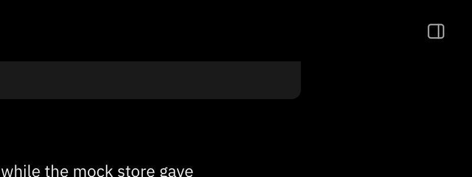
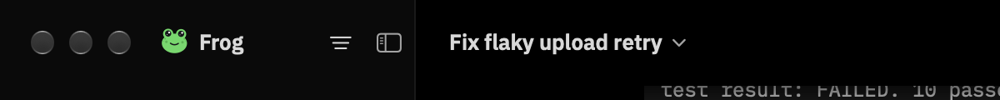
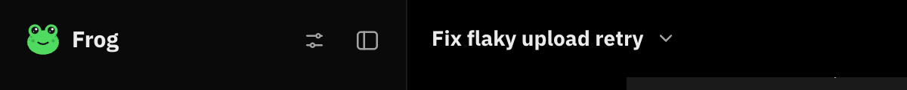
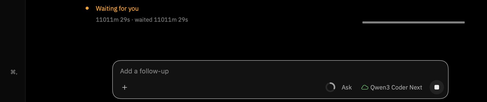
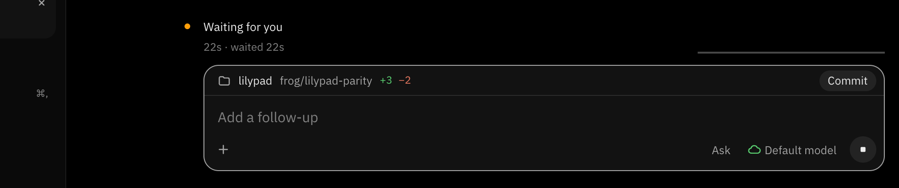

# Window chrome: what each app has today

Audited 2026-11-18 on main at v0.7.1 (`0dc36cf5`). Scope: every piece of the window that isn't the
transcript ([`../transcript/spec.md`](../transcript/spec.md)), Settings' rows
([`../app-shell.md`](../app-shell.md)) or the inspector's contents ([`../inspector`](../inspector)).
Those three are unified and stay as they are.

Pictures come from one fixture (the parity session, [`../parity/fixture.mjs`](../parity/fixture.mjs))
at 1280 × 800, dark: the Mac drawn off-screen by its own window (`-FrogSnapshot`), the web in
headless Chrome against the parity gateway. Full windows: [`parity/mac-dark-before.png`](parity/mac-dark-before.png),
[`parity/web-dark-before.png`](parity/web-dark-before.png). Measured positions:
[`parity/mac-dark-before.json`](parity/mac-dark-before.json), [`parity/web-dark-before.json`](parity/web-dark-before.json),
compared in [`parity/diff-dark-before.json`](parity/diff-dark-before.json) (`docs/design/chrome/parity/capture.sh`,
see [`parity/README.md`](parity/README.md)).

Verdicts: **same**, **look** (same job, drawn differently), **behaviour** (does something
different), **missing** (one app hasn't got it).

## Summary, most visible first

| # | Piece | Verdict | Spec |
| --- | --- | --- | --- |
| 1 | Top-right controls (split, palette, inspector) | missing on the web (2 of 3), look, behaviour | [spec](spec.md#1-the-top-right-controls) |
| 2 | Turn rail | missing on the web | [spec](spec.md#2-the-turn-rail) |
| 3 | Header: session title and its menu | look, behaviour | [spec](spec.md#3-the-header) |
| 4 | Sidebar width and brand row | look (250 vs 270 pt, icons), behaviour (shortcut) | [spec](spec.md#4-the-sidebars-brand-row) |
| 5 | Sidebar's first rows (New session, Search) | look (icon) | [spec](spec.md#5-later-pieces) |
| 6 | Composer's control row | missing on the web (context ring) | [spec](spec.md#5-later-pieces) |
| 7 | Inspector's tab row | behaviour (Mac moves it into the title row) | [spec](spec.md#5-later-pieces) |
| 8 | Menus and popovers | look (Mac native menus, web cards) | [spec](spec.md#what-stays-native-on-the-mac) |
| 9 | Toasts | missing on the Mac (as one piece) | [spec](spec.md#5-later-pieces) |
| 10 | Empty states | look | [spec](spec.md#5-later-pieces) |

## 1. The top-right controls

| | Mac | Web |
| --- | --- | --- |
| Drawn by | `apps/macos/Frog/Views/WorkspaceView.swift` (`.toolbar`, three `ToolbarItem(placement: .primaryAction)`) | `apps/web/src/App.tsx` (`.titlebar`, one `.ic-btn`) |
| Buttons | Split (`rectangle.split.2x1`), Commands (`command`), Inspector (`sidebar.right`) | Inspector only, a hand-drawn panel icon |
| Surface | The system's shared toolbar glass: one capsule 117 × 35 pt, 8.5 pt from the top, 6 pt from the right edge | None: a bare 30 × 30 icon button, radius 8 |
| Item frames (AX) | 40 / 36 / 45 wide × 52 tall, right edges at 85 / 49 / 4 pt | — |
| Tooltips | "Split pane (⌘\\)", "Command Palette (⌘K)", "Inspector: changes, terminal, preview (⌥⌘0)" | "Inspector" (no shortcut) |
| Inspector open | Button stays, no on state; the inspector's tabs join the title row left of it | Button disappears (`current && !inspector`); the inspector's own × closes it |
| Disabled | Split: can't split, or in Settings/Docs. Inspector: no conversation, or in a mode | Hidden with no session |
| Shortcuts | ⌘\\ split, ⌘K palette, ⌥⌘0 inspector | ⌘K palette only. **⌘\\ toggles the sidebar on the web** (`sideToggle`), the Mac's split key |
| Split panes | Yes (`Panes`, `PaneLayout`) | None |

Verdict: **missing** (split and palette buttons, ⌥⌘0), **look** (no group surface), **behaviour**
(the toggle vanishes while the inspector is open). Picture: Mac
 web 

## 2. The turn rail

| | Mac | Web |
| --- | --- | --- |
| Drawn by | `apps/macos/Frog/Views/TimelineRail.swift`, placed by `PaneView.rail` | — |
| Size | 28 pt wide (14 in a narrow split pane), height `min(room, 360, chapters × 18 + 28)`; glass capsule | — |
| Place | 8 pt under the title row (top 60), 8 pt from the pane's right edge, left of a docked inspector | — |
| Marks | Hairline; a soft thumb over the turns on screen; a dot per chapter (solid: your prompt, hollow: an autonomous run, a break: summarized); colour only where a turn needs you (red failed, orange stopped, accent running); yellow find marks; camera badge for preview checkpoints | — |
| Hover | Ring on the turn, a capsule label left of the rail: chapter title, turn number, prompt | — |
| Scrub | Click or drag jumps the transcript to the turn under the pointer, a haptic tick per turn | — |
| Menu | Show Turn, Fork After This Turn, Rewind to Before This Turn…, Compare with Now | — |
| Chapters | `apps/macos/Frog/Model/Chapters.swift` | — |

Verdict: **missing** on the web. The web's protocol has no fork or rewind op and the web has no
find bar or preview checkpoints, so those parts of the Mac's rail have nothing to act on there.

## 3. The header

| | Mac | Web |
| --- | --- | --- |
| Drawn by | `WorkspaceView.titleBar` / `threadTitleBar` (a toolbar item) | `App.tsx` `.titlebar` / `.title-wrap` |
| Row | The title bar, 52 pt | A 52 px flex row (48 at ≤ 760 px) |
| Title | 13 pt semibold, one line | 14 px bold (`<b style={{fontSize: 14}}>`) |
| Menu affordance | The whole title is the menu button; `chevron.down` 9 pt semibold, secondary, 5 pt after the text | A separate 24 × 24 chevron button (14 px stroke 2.2) beside the title |
| Menu | Native: Rename…, Archive, ─, Delete… (destructive) | Card: Rename, Archive/Unarchive, Delete session (warn colour) |
| Rename | A sheet with a field (`renamingTitle`) | Double-click the title, or Rename: edits in place |
| Tooltip | "Rename, archive or delete this conversation" | "Double-click to rename" on the title, "Session menu" on the chevron |
| Status | None in the row | "Connecting…", "Reconnecting…", "Disconnected", "Session deleted", "Update Frog to continue", right-aligned 12 px |
| In Settings | Breadcrumbs (`SettingsCrumbs`) | Breadcrumbs (`ui/Settings.tsx`), unified already |
| AX | identifier `title.menu`, label = the title | `Session menu` on the chevron |

Verdict: **look** (size, weight, where the chevron is), **behaviour** (rename sheet vs in place,
menu wording). The status words are web-only on purpose: the web talks to a sandbox over a
socket that can drop; a Mac session is in-process. Picture: Mac
 web 

## 4. The sidebar's brand row

| | Mac | Web |
| --- | --- | --- |
| Drawn by | `Views/SidebarTitleRow.swift` (a toolbar item beside the traffic lights) | `App.tsx` `.brand`, `ui/SessionList.tsx` (view options portal) |
| Width | 250 pt | 270 px |
| Mark | `FrogFace` 18 pt, "Frog" 13 pt semibold | `Mark` (larger, ~26 px), "Frog" bold ~14 px |
| View options | `line.3.horizontal.decrease`, native menu | A sliders icon, card menu |
| Collapse | `sidebar.left` 24 × 24, "Collapse the sidebar (⌃⌘S)" | Panel icon 26 × 26, "Hide sidebar ⌘\\" |
| Collapsed | `SidebarToggle` beside the traffic lights, with an amber dot and a hover list of live sessions | `.side-float` toggle at top left, no dot or list |

Verdict: **look** and **behaviour** (⌃⌘S vs ⌘\\, the waiting dot). The Mac's row sits right of the
traffic lights (84 pt), which the web hasn't got: that offset is a real platform difference.

## 5. The sidebar's first rows

New session: Mac `square.and.pencil`, web `+`. Search: same magnifier; the web shows ⌘K beside
it, the Mac doesn't. **Look.** (`Views/Sidebar.swift`, `ui/SessionList.tsx`.)

## 6. The composer's control row

| | Mac | Web |
| --- | --- | --- |
| Drawn by | `Views/ComposerView.swift`, `ComposerExtras.swift` | `ui/Composer.tsx` |
| Row, left to right | + (attach), ─, context ring, mode ("Ask"), model chip (place icon + name), send/stop | + (attach), ─, mode ("Ask"), model chip, send/stop |

Verdict: **missing** on the web: the context ring. (The web's model chip shows once the gateway
lists models; the first capture's gateway hadn't.) Picture: Mac 
web 

## 7. The inspector's tab row

Mac: `Views/PaneArea.swift` `.strip`. When the inspector is docked at the window's top-right its
tabs move into the title row (`cornerInspector`), left of the top-right controls; otherwise they
are the inspector's first row. Web: `ui/Inspector.tsx` `.insp-top`, always the inspector's first
row, with a × to close. **Behaviour.**

## 8. Menus and popovers

Mac: native `Menu` / `NSMenu` everywhere (title menu, view options, model picker's overflow,
context menus on rows and the rail). Web: `.f-card.cz-menu` cards with `role="menu"`, opened by
click, closed on leave. Native menus can't be drawn in an off-screen snapshot, so there is no
picture of the Mac's. **Look**, deliberate: see the spec's "What stays native".

## 9. Toasts

Web: one `.toast` (`App.tsx`, `role="status"`) for copied / archived / errors. Mac: no shared
toast; each feature says it in place (`ComposerExtras.swift` has its own transient line,
`Conversation.swift` posts notices into the transcript). **Missing** on the Mac as one piece.

## 10. Empty states

New session: Mac's centred frog and prompt (`Onboarding.swift`, `PaneView`), web's `home-hero`
(`App.tsx`). Session not found: web only (a link can name a session the account hasn't got; the
Mac opens only sessions it lists). Inspector tabs: unified (`InspectorEmpty`). **Look.**
