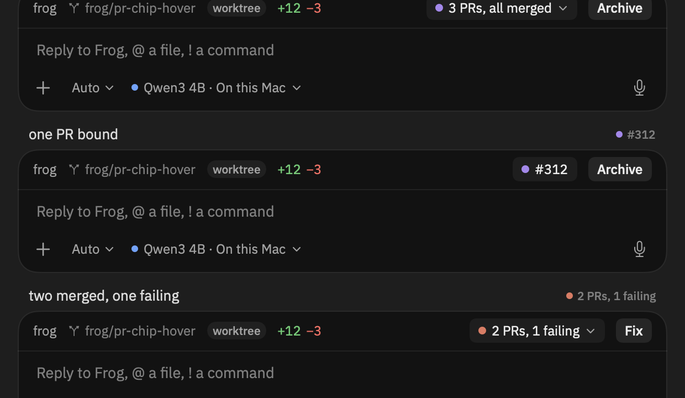
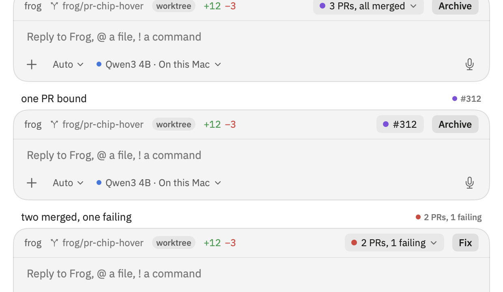

# The sidebar's PR status and the composer's pill

The two surfaces of one thread, drawn from one list (`docs/plans/2026-11-12-composer-tray.md`).

 

Each pair is a sidebar row (title, then the row's status on the right) over the composer for the
same thread. Three cases, left to right as they read down the shot:

| thread | row | composer pill |
|---|---|---|
| three merged PRs | 3 PRs, all merged | 3 PRs, all merged ▾ |
| one PR | #312 | #312 |
| two merged, one failing | 2 PRs, 1 failing | 2 PRs, 1 failing ▾ |

Both sides come from `ComposerModel.summary(_:)` over `GitIndex.prs(bound)`. They used to come
from different places — the composer from the engine's bound PRs, the row from a single number
scraped out of git's ancestor scan — so a thread with three PRs read "3 PRs, all merged" in the
composer and "#312" in the row, and the other two PRs weren't there at all.

`apps/macos/FrogTests/SidebarSnapshotTests.testRenderPRsAgreeing` draws this shot. Run it with
`FROG_PARITY_OUT` unset and copy the PNGs from `$TMPDIR/frog-snapshots/` (they're written there
by default):

```sh
cd apps/macos && xcodebuild test -project Frog.xcodeproj -scheme Frog \
  -destination 'platform=macOS,arch=arm64' -only-testing:FrogTests/SidebarSnapshotTests/testRenderPRsAgreeing
```
