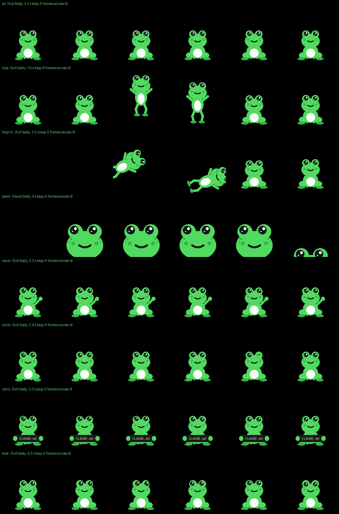
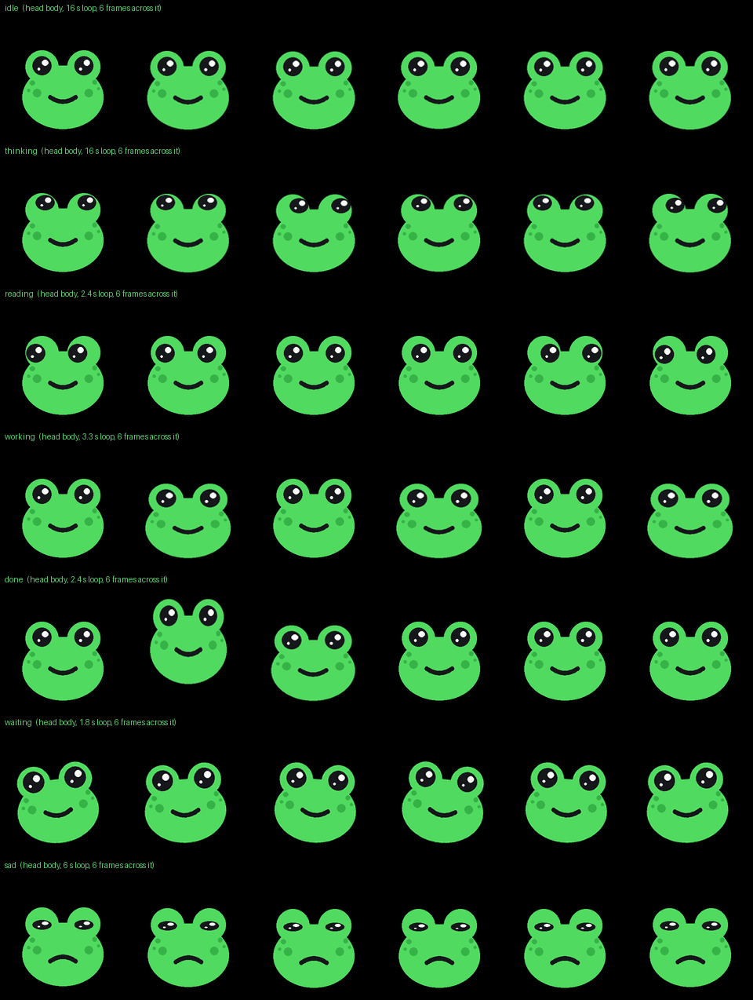
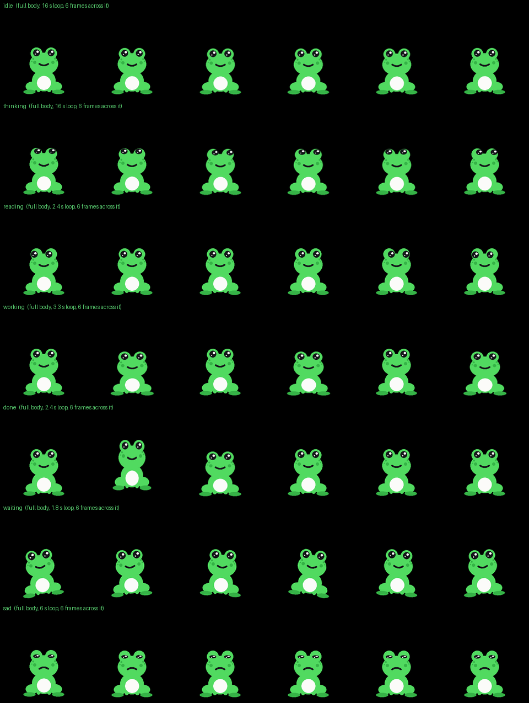

# frog-anim

The Frog mascot in motion, rendered from code: every frame is a pure function of time and a few
named parameters (action or mood, size, position, facing, colours, seed). It is the hype reel's
animated frog (`video/hype-reel/`), pulled out so other videos, the site and design work can use
it without copying the reel. CPU only: PIL and numpy draw, ffmpeg encodes. No models, no GPU.

The head is the locked mark (`apps/web/public/frog-mark.svg`, colours from `design/tokens.json`
`mark-*`); the moods are FrogKit's `FrogFace` loops, transcribed keyframe for keyframe, so a video
frog moves the way the apps' activity frog does. `tests/` checks both against their sources.

## Run

Needs `uv` and `ffmpeg`. The wrapper pins the reel's deps (Pillow 12.0.0, numpy 2.3.4):

```bash
video/frog-anim/frog-anim list
```

```bash
video/frog-anim/frog-anim render --action hop --size 512 --seconds 2 --fps 30 --out hop.mp4
```

Or install it (`uv tool install ./video/frog-anim`, or `pip install -e video/frog-anim`) and call
`frog-anim`. `python -m frog_anim` works too with the package on `PYTHONPATH`.

| command | output |
|---|---|
| `render --action hop --size 512 --seconds 2 --out hop.mp4` | 512x512 h264, 60 frames, 72 KB |
| `render --action carry --label "Qwen3 32B" --width 1280 --height 720 --background "#000000" --out carry.mp4` | 1280x720 h264, 96 frames, 24 KB |
| `render --action thinking --size 256 --transparent --out thinking.webm` | 256x256 VP9 with alpha, 480 frames (one 16 s loop), 364 KB |
| `render --action thinking --size 256 --transparent --out thinking.mov` | 256x256 ProRes 4444 with alpha, for editors, 27 MB |
| `render --action done --size 256 --transparent --out done.gif` | 256x256 GIF, transparent, 72 frames, 392 KB |
| `render --action waiting --size 256 --transparent --out waiting.apng` | 256x256 APNG, RGBA, 54 frames, 1.2 MB |
| `render --action sit --size 512 --seconds 1 --transparent --out sit-frames` | a directory of 30 RGBA PNGs, 840 KB |
| `render --action wave --size 1024 --at 0.5 --out wave.png` | one 1024x1024 RGBA still, 60 KB |
| `sheet --out sheet.png` | a contact sheet: a row of frames per action |

The format follows the extension: `.mp4`, `.webm`, `.mov`, `.gif`, `.apng`, `.png` (one still,
at `--at` seconds) or no extension (a directory of numbered PNGs). Without `--seconds` it renders
one loop of the action, so the file loops seamlessly. The background is transparent where the
format has alpha and black otherwise; `--transparent` or `--background '#rrggbb'` say so
explicitly (`--transparent` with `.mp4` is an error: mp4 has no alpha; use `.webm` or `.mov` to
drop the frog over other footage).

Other flags: `--width/--height` (canvas, overriding `--size`), `--body full|head`, `--facing
left` (mirrors it), `--seed N` (shifts its loops in time, so several frogs don't blink together),
`--frog-size` (head width in px) or `--zoom`, `--x/--y` (where its feet rest), `--label` and
`--font` (the `carry` chip), `--tokens design/tokens.json` (read the `mark-*` colours from a
tokens file instead of the built-in lock).

## Actions

Actions come from the hype reel and use the full body by default; moods come from the apps and
use the head alone, as the apps draw it. Either works with `--body full` or `--body head`.

| action | loop | what |
|---|---|---|
| `sit` | 3.2 s | sits and blinks |
| `hop` | 1.6 s | hops in place, squashes on landing |
| `hop-in` | 1.2 s | hops in from the side and lands (plays once) |
| `peek` | 3.0 s | head rises over the bottom edge, looks up, ducks |
| `wave` | 3.2 s | waves (the reel's "own" shot) |
| `wink` | 2.4 s | sits and winks |
| `carry` | 3.2 s | holds a chip (`--label`) and glances at it |
| `look` | 4.2 s | looks where it looks in the reel |



| mood | loop | what (FrogKit's `FrogMood`) |
|---|---|---|
| `idle` | 16 s | breathes and blinks |
| `thinking` | 16 s | looks up and drifts |
| `reading` | 2.4 s | scans a line |
| `working` | 3.3 s | pumps its throat, blinks |
| `done` | 2.4 s | hops |
| `waiting` | 1.8 s | tilts its head, wide eyes |
| `sad` | 6 s | droops and sinks, smile turned down |



The same moods on the full body:



Regenerate the sheets with `frog-anim sheet --actions sit,hop,hop-in,peek,wave,wink,carry,look
--cell 160 --out contact-sheets/actions.png` (and `--actions idle,thinking,…` for the moods).

## From Python (another video)

A compositor that draws its own frames uses the same building blocks the reel does:

```python
import sys; sys.path.insert(0, "video/frog-anim")   # or install the package
from PIL import Image
from frog_anim import rest, hop, layout, render_frame, Move, MOODS

def frame(t):
    img = Image.new("RGB", (1920, 1080), (0, 0, 0))
    # hop onto a spot between 1.0 and 1.5 s, then sit there with a landing squash
    hop(img, t, 1.0, 1.5, (-160, 760), (900, 800), size=180, height=300)  # nothing before 1.0 s
    # a second frog, thinking, on its head-only body
    body, eyes = MOODS["thinking"].pose(t)
    rest(img, t, 1500, 600, 140, "head", eyes=eyes, body=body)
    return img
```

- `rest(img, t, x, y, size, pose, land=, look=, blink=, wink=, label=, eyes=, frown=, body=, ...)`
  draws the frog resting with its anchor (between its feet; the head's bottom centre for
  `"head"`) at (x, y), `size` px head width. `land` is when it last touched down (the squash).
- `hop(img, t, t0, t1, p0, p1, size, height=...)` is the reel's hop: stretched and turned along
  the arc, then `rest` at p1. Its feet hang below the arc in the air, which suits entrances.
- `render_frame(action, t, layout(w, h, body), ...)` is one frame of a named action;
  `frames(...)` and `write(...)` are what the CLI uses.
- `sprite(...)` and `place(...)` are the drawing underneath: `sprite` is cached per pose, so
  hundreds of frames cost little.

Blinking on a beat is the caller's: pass `blink=` (the reel blinks on its beat grid, `comp.py`'s
`blinking(t)`), or use an action, which blinks on its own clock.

## Add an action

1. Write `_name(img, t, c)` in `frog_anim/actions.py`: draw the frog at time `t` with `rest()`,
   `hop()` or `place(sprite(...))`, using the `Ctx` `c` for position, size, body, facing,
   palette and `c.phase` (the seed's time offset). Keep it a pure function of `t`.
2. Register it in `ACTIONS` with its loop length and a one-line doc. A mood from the apps goes
   in `motion.py`'s `MOODS` instead, as `Track` data copied from `FrogFace.swift`.
3. Run the tests (below): `test_frog_stays_on_canvas` tells you if it needs more room
   (`render.py`'s `ROOM`), and regenerate the contact sheet.

Don't redraw the frog to make an action work: the mark's shapes and colours are locked
(`mark.py`, checked against the SVG and tokens). Poses are what `sprite()` already draws.

## Tests

```bash
cd video/frog-anim && uv run --no-project --with pillow==12.0.0 --with numpy==2.3.4 python -m unittest discover -s tests -v
```

Deterministic frames (same parameters, same hash, also in a fresh process), every action at
several sizes and both bodies, nothing clipped by the canvas, CLI outputs' dimensions, frame counts
and alpha, the mark against its sources. With `FROG_ANIM_REEL_BEFORE=<frames rendered by the reel
before the move>` and the reel's `footage/` present, it also renders 15 reel frames and checks they
are pixel-identical.

## Next consumers (not built)

- **The site's hero** (`site/index.html`): today it draws a different, older one-colour frog in
  inline SVG. A transparent `.webm` (with an `.apng` or `.gif` fallback) of `idle` or `sit` from
  here would put the real mark in motion there.
- **The apps' loading and thinking states**: FrogKit already animates the moods live in SwiftUI.
  A new thinking UI is being designed; this package gives that work the same motion vocabulary as
  rendered assets for mockups, docs and video, and the place to try new moods before they move to
  `FrogFace.swift`.
