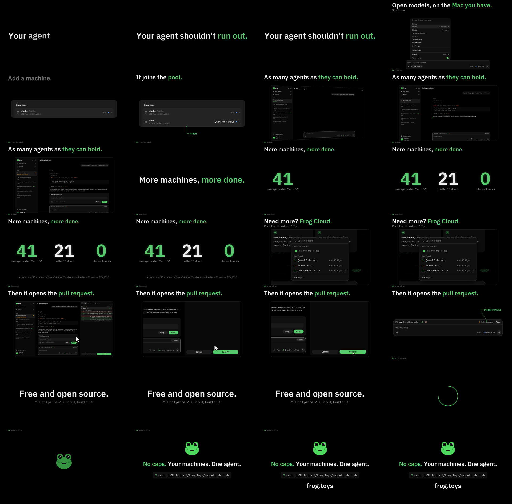

# Frog hype reel

A 42.6 second, 1920x1080, 30 fps reel telling the "no caps" story, rendered entirely from code.
It uses real frames of the web app (captured from a mock gateway in headless Chrome) and the Mac
app's checked-in snapshots. A compositor moves them, with every animation a pure function of time,
cut to the beat grid of the track it is timed to (see Music). No screen recording, no generative models, no paid
services; it renders on a Mac's CPU in a few minutes.

The pipeline is the board video's (vcad `hardware/pcb-motor-video/`): beat grid, pure-function
compositor, contact sheets, ffmpeg encode. The footage step is new.



## Re-render

```bash
TRACK=~/Downloads/"Lackvill - No Jumper.mp3" video/hype-reel/render.sh
```

It composites `build/frames/`, prepares `build/music.wav` (the track, or the synthesized
stand-in without `TRACK`) and encodes `frog-hype-reel.mp4`
(h264 crf 17, aac 256k), then writes `contact-sheet.png` from the mp4. Needs `uv`, `ffmpeg` and
`rsvg-convert`; Python deps are pinned in the script. `NPROC` (default 6) sets the workers.
The mp4, `build/` and `footage/` are not committed (`.gitignore`).

## Recapture the footage

```bash
video/hype-reel/capture/run.sh
```

Run it after the web app changes, then `render.sh`. It starts `capture/gateway.mjs` (port 8811),
vite dev against it (port 5211) and `capture/capture.mjs`, which drives the app in headless Chrome
(its own throwaway profile; nothing opens a window or takes the keyboard) and writes
`footage/<shot>/NNNN.png` at 2560x1440. Needs `npm ci` in `apps/web` and Google Chrome.

- The gateway serves an account (no name, the $1.00 sign-up credit), the pricing page's three Frog Cloud
  models, three repos and six sessions. `s_live` plays the parity fixture
  (`docs/design/parity/fixture.jsonl`, "Fix flaky upload retry") one step per frame, up to its ask
  card; replies stream three words a step. Steps are counted, not timed, so the turn's frames come out the same; the new-session screen's
  suggestion chips are random per load, so those differ.
- Shots: `type` (the prompt typed a character a frame, the where menu, lilypad picked), `stream`
  (the live turn), `inspector` (Changes, Commit, Open PR), `models` (the model menu with prices),
  `docs` (captured, not used yet). `run.sh probe` writes two stills for checking selectors.
- Mac footage is the checked-in offscreen snapshots, not a capture: `docs/design/composer/mac-where-menu-dark.png`
  and `mac-git-pr-dark.png` (`ComposerSnapshotTests`, see `docs/design/composer/`). Re-run those
  harnesses to refresh them; they build their own copy of the app.
- The mark is `apps/web/public/frog-mark.svg`, rasterized by `run.sh`.

## Files

| file | what |
|---|---|
| `beats.py` | the beat grid (`B(i)`) and the cut list, shared by picture and music |
| `comp.py` | the compositor: one function per shot, `view()` camera, words, rings, cursor |
| `music.py` | the track: kick, clap, hats, bass, pad, pluck arpeggio, risers; Am F C G |
| `sheet.py` | renders chosen beats through `comp.py` into a contact sheet, for review while editing |
| `render.sh` | the one command |
| `capture/` | gateway, CDP driver, shot list, `run.sh` |
| `fonts/` | IBM Plex Sans and Mono (SIL OFL, `OFL-IBM-Plex.txt`), the app's own type |

## Beat sheet

The story is the site's own line, "No caps. Your machines. One agent." (`site/index.html`,
`README.md:3`): an agent that doesn't run out, because it runs open models on machines you own,
and every machine you add makes the pool bigger. No other product is named or shown.

Cut to Lackvill, "No Jumper": 129.98 BPM, first kick at 0.098 s, so beat i is at
0.098 + i × 0.4616 s (`beats.py`). Drops land on the reel's two best images: the bench numbers
(beat 32, after the track's dip at 28) and the end card (beat 80, after its breakdown at 72).

| beats | time | shot | on screen | source of the claim |
|---|---|---|---|---|
| 0–8 | 0.1–3.8 s | black; a word lands on each beat, then holds through the track's dip | Your agent shouldn't run out. | the premise of `README.md:3,6-7` ("No caps", "no rate limits") |
| 8–12 | 3.8–5.6 s | Mac composer's where menu: This Mac (frog, zest), Frog Cloud below; model Qwen3 8B on this Mac | Open models, on the Mac you have. / $0 a token. | `README.md:29` ("Local models run on this machine and cost nothing"), `site/pricing.html` ("On your own machines: $0") |
| 12–14 | 5.6–6.6 s | the node install line, then its comment on the next beat | Add a machine. | `README.md:59`, `site/index.html` ("installs tang-llm, prints a pairing code") |
| 14–20 | 6.6–9.3 s | Mac Settings › Models › Machines: studio (This Mac, M4 Max); on beat 16 mew (RTX 3090, Qwen3-4B at 58 tok/s) appears, with a "joined" callout | It joins the pool. | `README.md:13` ("Pair another Mac or a Linux GPU box with a 6-digit code and it joins one pool") |
| 20–28 | 9.3–13.0 s | web, as a card that turns from a 3/4 view to flat: six sessions in the sidebar, the open one streaming a turn, a step every half beat | As many agents as they can hold. | `README.md:6-7` ("Run as many agents as your machines can hold, with no rate limits") |
| 28–32 | 13.0–14.9 s | the track's dip: the claim alone on black | More machines, more done. | |
| 32–44 | 14.9–20.4 s | the drop: 41, 21 and 0 slam in on beats 32, 34 and 36, each landing on the next beat and holding; the reel's only glow | 41 tasks passed on Mac + PC / 21 on the PC alone / 0 rate-limit errors / Six agents for 15 minutes on Qwen3-8B: an M4 Max Mac added to a PC with an RTX 3090. | `site/index.html` "No caps" section, `docs/no-caps-bench.md` (run `swarm-2026-11-11-mac-mew-8b`), `README.md:15-17` |
| 44–52 | 20.4–24.1 s | web model menu as a card, held still: Frog Cloud's models, "from $0.13/M" | Need more? Frog Cloud. / Per token, at cost plus 10%. | `README.md:7`, `site/pricing.html` (OpenRouter models "billed at what each request cost there plus 10%") |
| 52–60 | 24.1–27.8 s | web Changes panel, pushing in; the cursor clicks Open PR on beat 57 | Then it opens the pull request. | `docs/releases/v0.6.0.md` (`open_pr_when_done = "auto"`), `apps/web/README.md` (Open PR is a message to the agent) |
| 60–64 | 27.8–29.6 s | Mac composer: `frog/sidebar-polish`, +48 −12, "#412 checking", with a "checks running" callout | (same) | as above |
| 64–74 | 29.6–34.3 s | type only | Free and open source. / MIT or Apache-2.0. Fork it, build on it. | `README.md:5`, License section |
| 74–80 | 34.3–37.0 s | the breakdown: a green ring draws a quarter each beat, then becomes the mark | | |
| 80–92 | 37.0–42.6 s | the drop: the line, the install line, frog.toys; fade over the last second | No caps. Your machines. One agent. / `curl -fsSL https://frog.toys/install.sh \| sh` / frog.toys | `README.md:3,10` |

Editing rules, from the board video's notes: text lands whole (no typing on), and motion steps
on beats (words, rows, counters, the turn). The UI sits in cards with a margin, never edge to
edge. A section label bottom left carries across the cuts. There is one perspective move (the
agents card), glow only on the bench numbers, callouts with leader lines instead of bare rings,
and push-ins alternate with holds.

The bench beat leaves out the site's caveat ("one task got slower with the second machine") and
the doc's note that the baseline was slightly flattered; both are in `docs/no-caps-bench.md`.
The six web sessions are Frog Cloud sessions from the capture gateway; the web app streams only
the open one, so only it shows "Working…".

Prices on screen ("from $0.13/M", "from $0.17/M") are the pricing page's static table
(`site/pricing.html`), served by the capture gateway. The live page loads current prices from
`api.frog.toys/v1/models`, so recapture if they move. "Plus 10%" is the rule for models served
through OpenRouter; Frog Cloud's own GPUs list their own prices.

## Music

The cut is timed to **Lackvill, "No Jumper"** (Cam's mp3, not in the repo). It is a commercial
release: fine for a private cut, but publishing the reel needs a licence for it, or the stand-in
below. `TRACK=<path to the mp3> render.sh` uses it from its start, cut to 42.6 s, 1.5 dB down,
2 s fade. Measured on the encoded mp4: −12.6 LUFS integrated, true peak −1.3 dBFS. The grid was
fitted, not heard: nobody has checked the sync by ear.

Without `TRACK`, `music.py` synthesizes an original stand-in on the same grid (Am F C G, sine,
saw and noise, fixed seed, no samples), safe to publish but plainer.
